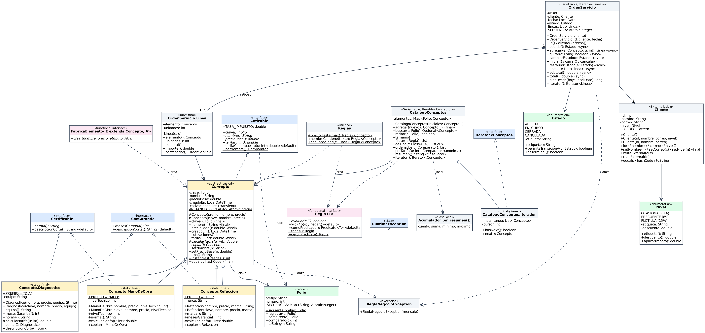
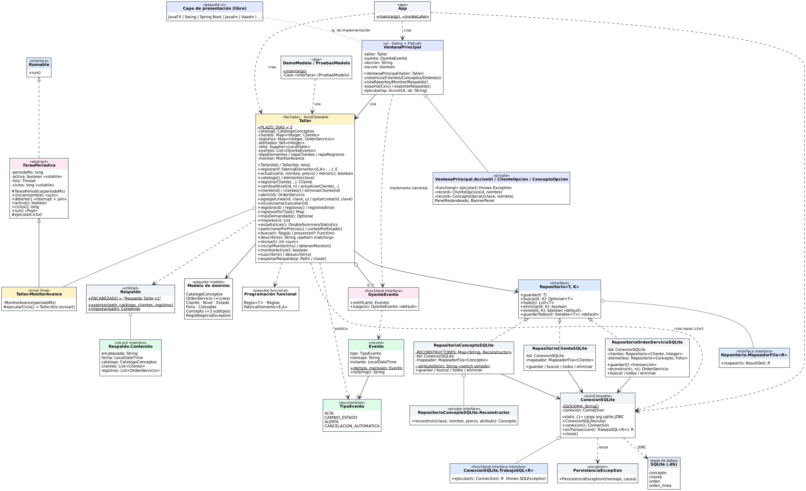
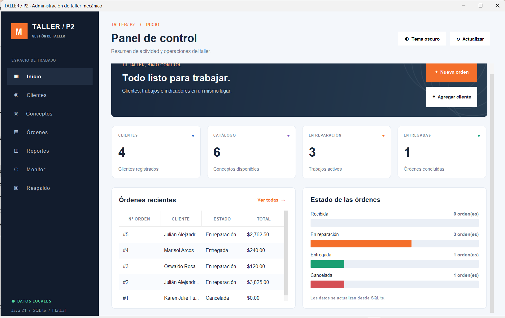
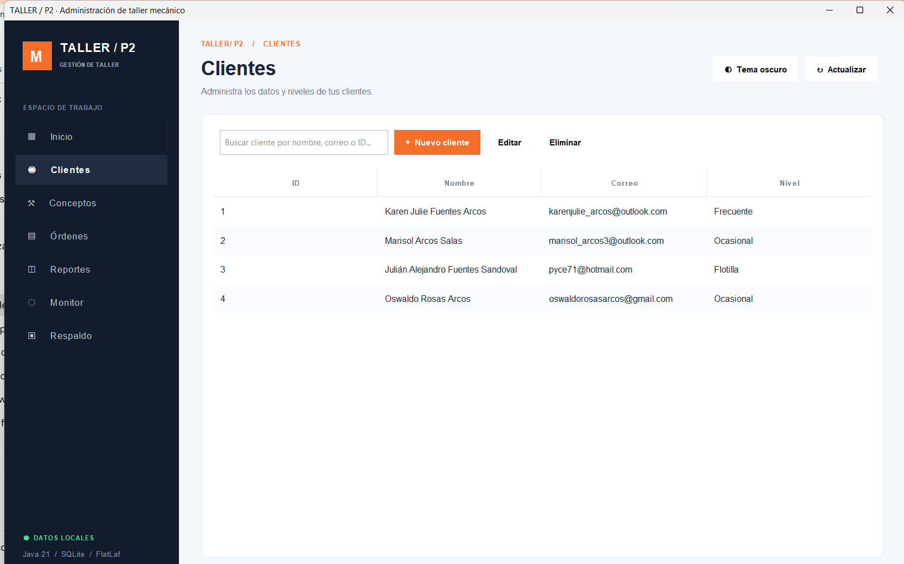
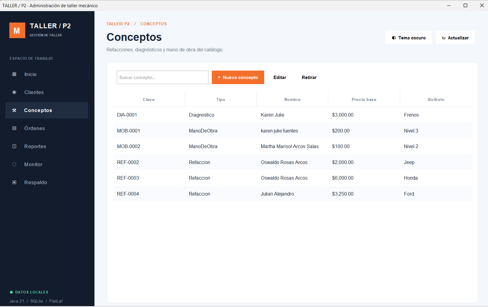
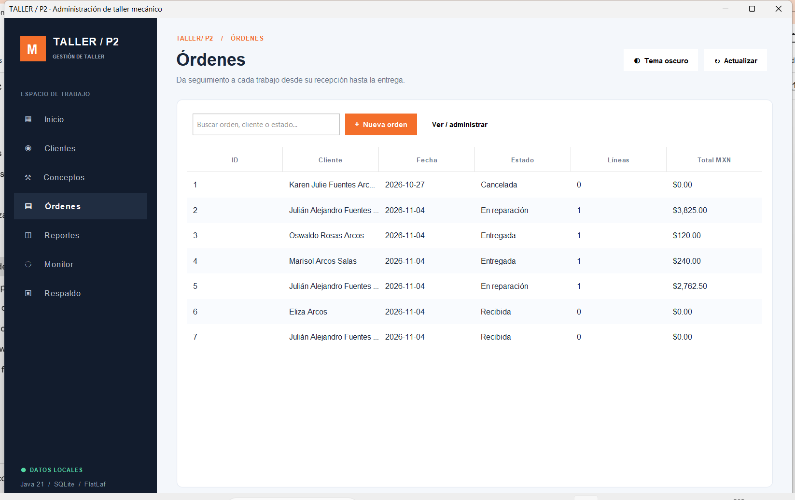
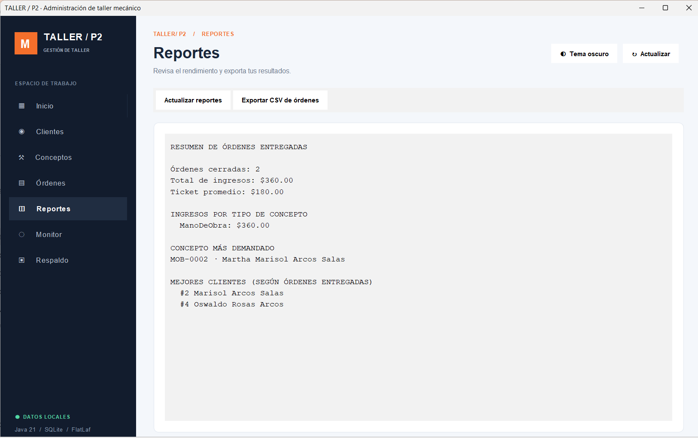
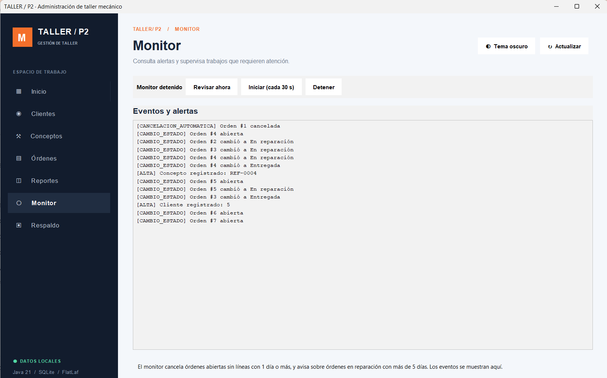
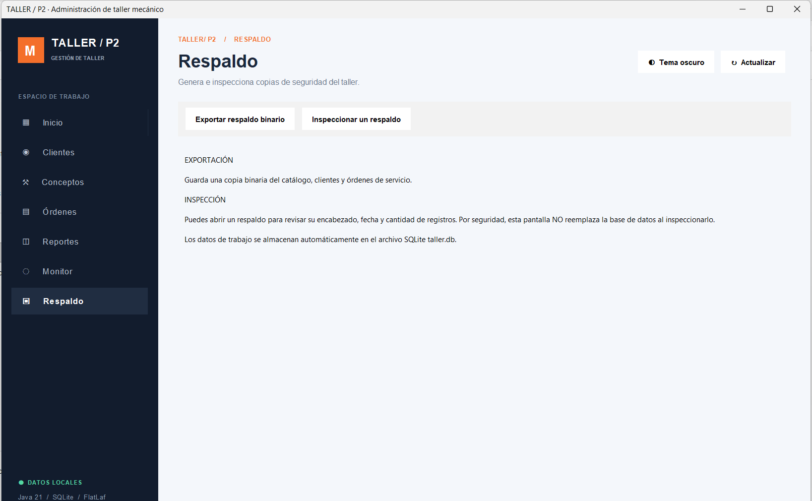

# Miniproyecto 2: Gestión de Órdenes de Servicio de un Taller Mecánico

Aplicación de escritorio para registrar clientes, conceptos de cobro (refacciones, mano de obra y diagnósticos) y órdenes de servicio de un taller mecánico, con persistencia en SQLite y reportes de ingresos.

- **Materia:** Tecnologías de Programación
- **Autora:** Karen Julie Fuentes Arcos — Maestría en Sistemas Computacionales
- **Profesor:** Dr. Ulises Juárez Martínez
- **Institución:** TecNM Campus Orizaba
- **Paquete raíz:** `mx.tecnm.orizaba.tp.taller`
- **Variante:** esqueleto (ver [TODO.md](TODO.md) para el avance)

## Tecnologías

| Componente | Versión |
|---|---|
| Java | 21 |
| Maven | 3.x |
| SQLite (`sqlite-jdbc`) | 3.46.1.3 |
| Interfaz gráfica | Swing + FlatLaf 3.4.1 |

## Funcionalidades

- **Catálogo de conceptos** con folios automáticos (`REF-0001`, `MOB-0002`, `DIA-0003`):
  - *Refacción*: precio por pieza, con garantía.
  - *Mano de obra*: 10 % adicional por cada nivel técnico (1 a 3), certificable.
  - *Diagnóstico*: la primera revisión a precio completo y las siguientes al 50 %, con garantía y norma.
- **Clientes** con correo validado y nivel de descuento: Ocasional (0 %), Frecuente (8 %) y Flotilla (15 %).
- **Órdenes de servicio** con varias líneas (concepto + unidades). El total aplica el descuento del cliente.
  - Estados: `ABIERTA → EN_CURSO → CERRADA`, o `ABIERTA/EN_CURSO → CANCELADA`.
  - Solo se editan líneas mientras la orden está abierta.
- **Reportes:** ingresos por tipo de concepto, concepto más demandado, mejores clientes, estadísticas de órdenes cerradas, conteo por estado y exportación a CSV.
- **Monitor en segundo plano:** revisa periódicamente las órdenes. Genera una alerta cuando una orden en reparación supera los 5 días (`PLAZO_DIAS`) y cancela automáticamente las órdenes abiertas sin líneas después de 1 día.
- **Eventos:** la interfaz se suscribe a altas, cambios de estado, alertas y cancelaciones automáticas.
- **Respaldo:** exporta e inspecciona catálogo, clientes y órdenes en un archivo serializado.

## Estructura del proyecto

```
P2_taller/
├── src/main/java/mx/tecnm/orizaba/tp/taller/
│   ├── modelo/         Concepto (+3 subtipos), Folio, Cliente, OrdenServicio, CatalogoConceptos, Nivel, Estado...
│   ├── funcional/      Regla<T>, Reglas, FabricaElemento<E, A>
│   ├── concurrencia/   TareaPeriodica (plantilla de hilo periódico)
│   ├── eventos/        Evento, TipoEvento, OyenteEvento
│   ├── persistencia/   Repositorio<T, K>, repositorios SQLite, ConexionSQLite, Respaldo
│   ├── servicio/       Taller (fachada) y Taller.MonitorAvance
│   ├── ui/             VentanaPrincipal (Swing)
│   └── app/            App, DemoModelo, PruebasModelo
├── diagramas/               Diagramas originales proporcionados por el profesor
├── diagramas_actualizados/  Diagramas actualizados con las extensiones del proyecto
├── Imagenes/                Capturas de pantalla de la aplicación
├── lib/                     JAR de SQLite para compilar sin Maven
├── compilar.sh · probar.sh
├── pom.xml
├── BITACORA_IA.md
└── TODO.md
```

Dependencias entre capas: `ui` → `servicio` → (`modelo`, `funcional`, `persistencia`, `eventos`, `concurrencia`). La interfaz solo habla con `Taller`.

## Cómo ejecutar

### Con Maven

```bash
mvn -q compile && mvn -q exec:java        # PruebasModelo (pruebas del modelo)
mvn -q exec:java -Pdemo                   # DemoModelo (demostración por consola)
mvn -q exec:java -Dexec.mainClass=mx.tecnm.orizaba.tp.taller.app.App   # Interfaz gráfica
```

### Sin Maven (Linux/macOS)

1. Descarga `sqlite-jdbc-3.46.1.3.jar` (Maven Central: `org.xerial:sqlite-jdbc`) y colócalo en `lib/`.
2. Ejecuta:

```bash
./compilar.sh     # compila a ./out
./probar.sh       # corre PruebasModelo
```

> La interfaz gráfica también requiere `flatlaf-3.4.1.jar` en el classpath si no usas Maven.

La base de datos `taller.db` se crea en el directorio desde el que se ejecuta el programa.

## Diagramas

Los diagramas actualizados con las extensiones del proyecto están en [`diagramas_actualizados/`](diagramas_actualizados/). La carpeta [`diagramas/`](diagramas/) conserva los diagramas originales del profesor, como referencia.

| Diagrama | Fuentes editables | Imagen |
|---|---|---|
| Figura 1. Clases del modelo | [`modelov2.puml`](diagramas_actualizados/modelov2.puml) · [`modelo.dot`](diagramas_actualizados/modelo.dot) | [`modelo.png`](diagramas_actualizados/modelo.png) |
| Figura 2. Paquetes y dependencias | [`arquitectura.puml`](diagramas_actualizados/arquitectura.puml) · [`arquitectura.dot`](diagramas_actualizados/arquitectura.dot) | [`arquitectura.png`](diagramas_actualizados/arquitectura.png) |

### Figura 1. Diagrama de clases del modelo

Muestra la jerarquía sellada de `Concepto` (con sus tres subtipos y las capacidades `ConGarantia` y `Certificable`), la composición `OrdenServicio ◆ Linea`, el catálogo con su iterador interno, `Folio`, los enums `Nivel` y `Estado`, y los tipos funcionales (`Regla`, `Reglas`, `FabricaElemento`).



### Figura 2. Paquetes y dependencias

Muestra la fachada `Taller`, el monitor (`MonitorAvance` sobre `TareaPeriodica`), los eventos, los repositorios SQLite, el respaldo, la interfaz gráfica y los programas de la aplicación.



### Regenerar las imágenes

```bash
dot -Tpng diagramas_actualizados/modelo.dot -o diagramas_actualizados/modelo.png
dot -Tpng diagramas_actualizados/arquitectura.dot -o diagramas_actualizados/arquitectura.png
```[README.md](README.md)

Los archivos `.puml` se pueden abrir en [plantuml.com](https://www.plantuml.com/plantuml) o con el plugin de PlantUML de IntelliJ.

## Capturas de pantalla

Capturas de la aplicación en ejecución (carpeta [`Imagenes/`](Imagenes/)). En la interfaz los estados se muestran como *Recibida*, *En reparación*, *Entregada* y *Cancelada*, que corresponden a `ABIERTA`, `EN_CURSO`, `CERRADA` y `CANCELADA` del modelo.

### Inicio
Panel de control con el resumen de clientes, conceptos, trabajos activos y órdenes concluidas, además de las órdenes recientes y la distribución por estado.



### Clientes
Alta, edición y eliminación de clientes, con búsqueda por nombre, correo o ID y su nivel de descuento.



### Conceptos
Catálogo de refacciones, mano de obra y diagnósticos con su folio, precio base y atributo propio (marca, nivel técnico o equipo).



### Órdenes
Listado de órdenes con cliente, fecha, estado, número de líneas y total.



### Reportes
Resumen de órdenes entregadas: ingresos totales, ticket promedio, ingresos por tipo de concepto, concepto más demandado y mejores clientes. Permite exportar a CSV.



### Monitor
Eventos y alertas en tiempo real. El monitor revisa las órdenes en segundo plano y puede iniciarse, detenerse o ejecutarse manualmente.



### Respaldo
Exportación de una copia binaria del catálogo, clientes y órdenes, e inspección de un respaldo existente.



## Conceptos de programación aplicados

Clases abstractas y selladas, interfaces con métodos `default` y `static`, genéricos acotados, clases internas (miembro, local y anónima), `record` y `enum` con comportamiento, expresiones lambda y referencias a métodos, Streams y Collectors, `switch` con pattern matching, hilos y sincronización (`synchronized`, `volatile`), serialización (`Serializable` y `Externalizable`), JDBC con transacciones y el patrón Repositorio.

## Avance

Estado de los pendientes (`// TODO Exx` en el código): consulta [TODO.md](TODO.md).

## Bitácora

La bitácora de uso de inteligencia artificial está en [BITACORA_IA.md](BITACORA_IA.md).
